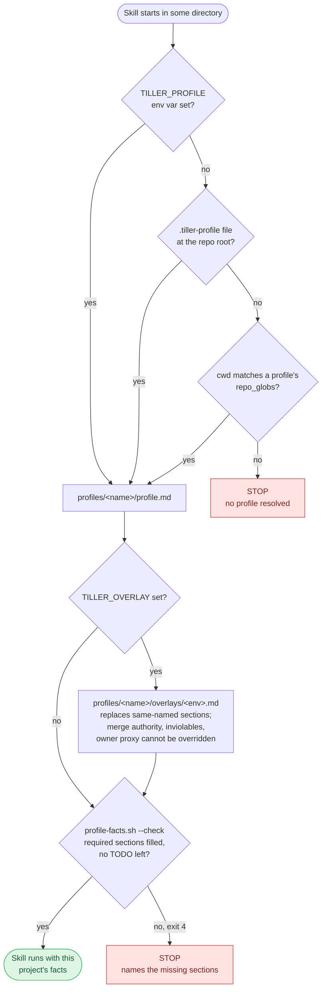
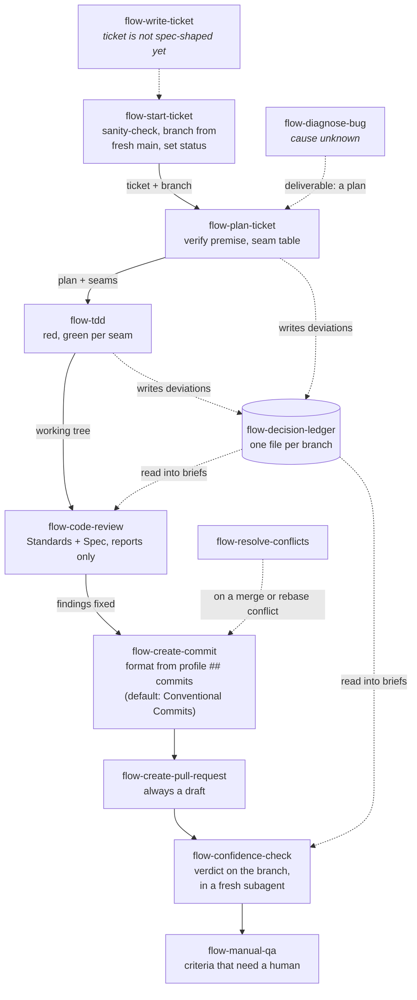
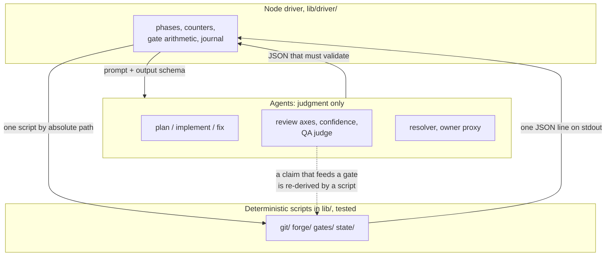
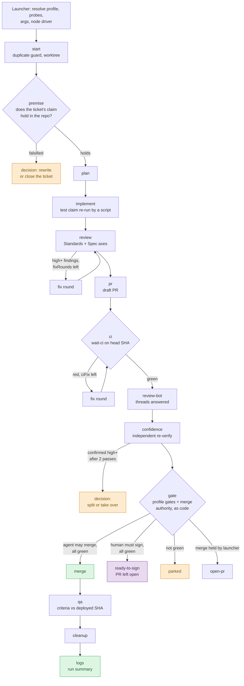
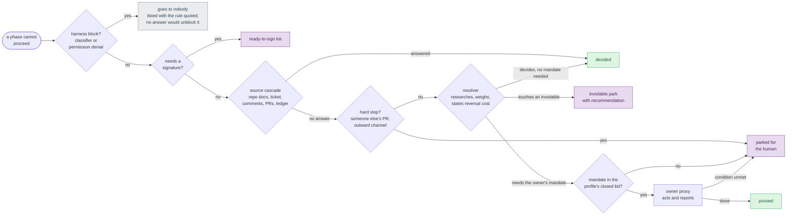
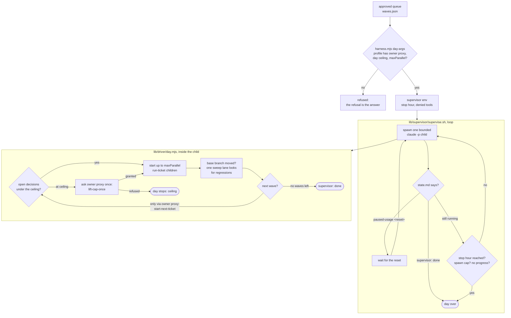

# tiller

Project-agnostic agent skills, plus one local profile per project carrying the facts that differ.

The skills carry no project facts, so a team adopts them by writing a profile, not by forking a
skill. Nothing is installed automatically: `install.sh` symlinks into `~/.claude/skills/` only when
it is run by hand.

## Why it exists

Skills that grow inside one project absorb that project's facts: its merge-signature rule, its
worktree flow, its staging hosts, its test commands. Most of what they teach is not project-specific
at all; it is how a ticket gets opened, reviewed, tested and merged anywhere. This repo separates the
two, so any project gets the procedure without inheriting another project's merge rule.

What couples a skill to a project is hardcoded **paths, repo names, merge rules and toolchain
commands**, not the examples in its prose. Those facts live in the profile; the skill reads them.

## Layout

```
skills/flow-*/             the procedure, with no project facts in it
profiles/_template/        tracked: the starting point for a profile
profiles/<name>/           local, git-ignored: profile.md, cases.json, secrets.env, leak-terms.txt,
                           and optionally skills/ and agents/ that only make sense for that project
personal/_templates/       tracked: templates for one person's generated skills
personal/<user>/           local, git-ignored: one person's skills and leak-terms.txt
lib/resolve-profile.sh     cwd -> profile, or a hard failure
lib/profile-facts.sh       profile -> the facts the driver branches on, or a hard failure
lib/new-profile.sh         create profiles/<name>/ from the template
lib/discovery/             discovery brains: new, check, status (flow-discovery)
lib/leak-guard.sh          refuse tracked content that names a project, a person or a credential
lib/testing/               synthetic fixtures for tests (never a real profile)
brains/_template/          tracked: how to attach a brain
brains/<name>/             local, git-ignored: one vault, its own git repo
brains/access.json         local, git-ignored: which project may read or write which brain
lib/resolve-brains.sh      cwd -> granted brains, or a hard failure
lib/brain-access.sh        print or edit brains/access.json
lib/hooks/private-access.sh  deny tools that reach an ungranted brain or another project's profile
helm/                      local, git-ignored: clone of the private cross-project helm
lib/helm/                  helm CLI, record.sh, template; lib/hooks/helm-session.sh at session start
```

Each skill opens with a `Step −1` that resolves the profile and reads it. **No profile resolves →
the skill stops.** That is the safety property the design is for: a skill must never apply one
project's merge authority to another project because it guessed.

## Setup

From a fresh clone to a working session, in order:

```bash
git clone <this repo> ~/src/tiller && cd ~/src/tiller
git config core.hooksPath .githooks          # leak guard on every commit

# 0. Prerequisites: node >= 20.11, git, bash, jq; gh and claude optional. Every install.sh call
#    checks them first and refuses when one is missing; this installs them through the platform's
#    package manager (brew, apt, dnf, apk, pacman, winget) after showing the plan.
./install.sh --prereqs                        # Windows: .\install.ps1 from PowerShell, see below

# 1. Shared skills and harness roles. Every skill install also records TILLER_HOME where the
#    agents read their environment: the "env" object of ~/.claude/settings.json (with
#    TILLER_MACHINE), ~/.codex/config.toml for --target codex, and one line in the shell's rc file.
./install.sh all                              # symlink every flow-* skill into ~/.claude/skills
./install.sh --target codex all               # the same for Codex (~/.agents/skills)
./install.sh --agents [--profile <file>]      # write flow-resolver, flow-owner-proxy, flow-pm to ~/.claude/agents

# 2. One profile per project (see Profiles below)
lib/new-profile.sh acme                       # also seeds profiles/acme/leak-terms.txt with the name
echo acme > ~/src/acme-web/.tiller-profile    # or repo_globs in the profile's frontmatter

# 3. Personal skills (asks questions in a terminal; --answers <file.json> without one)
./install.sh --setup-personal <user>

# 4. Project-only skills and agents, if the profile has any
./install.sh --profile acme all               # profiles/acme/skills/* and profiles/acme/agents/*.md

# 5. Private access: merge the printed fragment into ~/.claude/settings.json, then restart
./install.sh --hooks                          # brains and other projects' profiles, see brains/_template/

# 6. Helm, optional: one private repository shared by every machine
./install.sh --helm <git-url>                 # or --helm --new <git-url> for a first machine
# TILLER_MACHINE is the host name unless set; add TILLER_MACHINE_CAPS (e.g. calendar) by hand
```

`TILLER_HOME` must be set wherever the skills run; each skill's `Step −1` calls
`$TILLER_HOME/lib/resolve-profile.sh`. Without it every skill resolves no profile and stops, which
is the correct failure but an opaque one. `install.sh` writes it for Claude Code, Codex and the
terminal and keeps any value set by hand; another agent needs it in its own environment. Restart
the session after installing.

### Windows

The shell entry points run in Git Bash; `install.ps1` bootstraps it:

```powershell
git clone <this repo> C:\src\tiller; cd C:\src\tiller
.\install.ps1 all            # installs Git, Node LTS, jq, gh, claude through winget as needed, then runs install.sh all
.\install.ps1 --hooks        # any install.sh form works the same way
```

- `install.sh` writes `TILLER_HOME` and `CLAUDE_CODE_GIT_BASH_PATH` into `settings.json` in the
  `C:/src/tiller` form (forward slashes), which bash and Node both read; `/c/src/tiller` is
  bash-only. `install.sh --hooks` prints its paths the same way.
- `ln -s` needs Developer Mode (Settings > System > For developers); `install.ps1` enables it when
  run as administrator. Without it `install.sh` links skills as junctions, which work the same.
- The unattended drivers (`flow-run-ticket`, `flow-run-day`) are not supported on Windows; the
  interactive `flow-*` skills are.

## Profiles

A profile is a folder, `profiles/<name>/`, and stays on the machine that uses it:

```bash
lib/new-profile.sh acme                 # copies profiles/_template/ to profiles/acme/
$EDITOR profiles/acme/profile.md
lib/profile-facts.sh --check --profile profiles/acme/profile.md
lib/leak-guard.sh
```

Resolution order: `TILLER_PROFILE` env var → a `.tiller-profile` file at the repo root (one line,
the profile name) → `repo_globs` in a profile's frontmatter → fail.

An unattended run needs the facts as values rather than as a file: the driver reads no profile, so
every fact it branches on is rendered once, before anything spawns. `lib/profile-facts.sh` renders
them and refuses when a required section is unfilled, including one that still reads `TODO`:

```bash
"$TILLER_HOME/lib/profile-facts.sh" --check ~/src/acme-web
# -> per-key report; exit 4 means a launch against this profile would be refused
```

The contract (required sections, the facts object, the rule that a profile carries facts and never
procedure) is [docs/profile-schema.md](docs/profile-schema.md); filling a new one is
[docs/adding-a-project.md](docs/adding-a-project.md) and `profiles/_template/README.md`.
Credentials go in `profiles/<name>/secrets.env` (mode 600), never in `profile.md`.

A skill or agent that only makes sense for one project (a QA lane for that product, a simulator
for its domain) lives in `profiles/<name>/skills/<skill>/` or `profiles/<name>/agents/<agent>.md`
and is installed with `./install.sh --profile <name> all`.

## Personal skills

Skills about one person rather than one project (a daily note, a writing voice) are generated into
`personal/<user>/`, which is git-ignored. `install.sh --setup-personal <user>` generates and links
them, `install.sh --personal <user> all` re-links; a plain `all` never does. The mechanism and the templates: `personal/_templates/README.md`.

## Helm

The helm is a private overview above the profiles: which project is at which stage, what is next,
what is due, what was promised, which machine holds which clone. It lives in its own git
repository, cloned into `helm/`, and is shared by every machine that runs tiller.

Projects write to it and never read it: `flow-*` skills call `lib/helm/record.sh` at fixed
milestones, which stamps the resolved profile, and the private-access hook denies a project
session every path under `helm/`. Each write is a new file under `events/`, so two machines never
conflict. At session start `lib/hooks/helm-session.sh` prints at most five lines: overdue, due
within 48 hours, parked, stale projects, machines that have not synced. `flow-helm` gives the full
status and proposes calendar events. It advises; it never starts work. Design:
`docs/superpowers/specs/2026-10-14-helm-design.md`.

## Leak guard

Every tracked file must stay free of project, company and personal facts. `lib/leak-guard.sh` scans
the files git would track against the local lists `profiles/*/leak-terms.txt` and
`personal/*/leak-terms.txt` (one case-insensitive extended regex per line), plus credential shapes.
`.githooks/pre-commit` runs it with `--staged`; `git config core.hooksPath .githooks` enables it.
A hit means the fact belongs in a profile, not that the term list is wrong.

## Skills

| Skill | Role |
|---|---|
| `flow-start-ticket` | open work on a ticket: branch, status, plan |
| `flow-plan-ticket` | turn a specified ticket into a plan |
| `flow-brainstorm` | explore what to build before a ticket exists; one recorded decision |
| `flow-tdd` | build test-first |
| `flow-code-review` | two-axis review, no verdict |
| `flow-confidence-check` | final verdict on a finished branch |
| `flow-diagnose-bug` | find and prove a cause |
| `flow-decision-ledger` | record a deviation or a post-ticket agreement |
| `flow-create-commit` | commit in the profile's `## commits` format |
| `flow-create-pull-request` | open a draft PR |
| `flow-resolve-conflicts` | resolve a conflicted merge or rebase; reads `## generated files` |
| `flow-run-ticket` / `flow-run-day` | launch an unattended ticket or day run |
| `flow-resolver` | settle an open question; inviolables come from the profile (`docs/escalation.md`) |
| `flow-owner-proxy` | act in the owner's place, inside the profile's closed mandate |
| `flow-retro` | read a day's runs as a whole and propose edits with evidence; applies nothing (`skills/flow-retro/bin/retro.mjs`) |
| `flow-write-ticket` | write or clean up a ticket; conventions from `## ticket conventions` |
| `flow-pm` | keep the board true; mandate from `## board` |
| `flow-manual-qa` | decide which criteria need a human; register from `## verification register` |
| `flow-onboard-project` | create a profile from detected facts and a human's answers; report drift (`lib/onboard/onboard.mjs`) |
| `flow-helm` | cross-project status, reminders and calendar proposals from the private helm |

## The harness in pictures

Six diagrams, widest view first. They render on GitHub; other viewers need a Mermaid-capable preview.

### 1. Which project am I in?

Every skill starts with this. No profile resolved means no work.



### 2. One ticket, by hand

The interactive path. Each box is one skill; the arrow is what it hands on.



`flow-pm` sits beside this line: it reconciles the board with the artefacts and is never a step in it.

### 3. The layers of an unattended run

The driver (`lib/driver/`) holds the phases, the counters and the gate arithmetic. It runs the
deterministic scripts itself, one process per call, and reaches a model only through judgment lanes.



Lane tiers come from `config/routing.json`: T1 haiku, T2 sonnet (prose, logs, premise), T3 opus
(every lane that can open a gate). A gate lane is never routed below the session's tier.

### 4. One ticket, unattended (`flow-run-ticket`)

The fourteen phases of the ticket driver (`lib/driver/phases.mjs`). Each writes a checkpoint, so a
dead run resumes at the phase it died in.



Ready-to-sign is not a failure: it is the run finishing on a path the profile's `## merge authority`
reserves for a human signature.

### 5. When a run gets stuck: the escalation chain

Every question walks the same chain, one hop at a time (`lib/escalation/route.mjs`). Only the lists
(inviolables, mandates, hard-stop channels) come from the profile.



The owner proxy's vocabulary is six mandates: `approve-day-queue`, `start-next-ticket`,
`approve-peer-step`, `resume-run`, `lift-cap-once`, `undraft-pr`. It never signs and never writes to
a hard-stop channel.

### 6. A whole day, unattended (`flow-run-day`)

A day is waves of ticket runs. The supervisor is a plain shell loop on purpose: it has no context to
grow, and its only decision is reading `state.md`.



Harness blocks and ready-to-sign parks never count toward the ceiling. The report back lists
ready-to-sign PRs, open decisions and sweep regressions, with every gate re-read from the forge.

## Wayfinding

`/wayfinder` charts a foggy effort as a map of decision tickets on "this repo's issue tracker". Here
the maps live in one private repo kept apart from every delivery board: a decision ticket is not a
deliverable, and on a sprint board it distorts the board and leaks internal vocabulary into tickets
that must carry none.

The skill is **not forked**. `wayfinding/issue-tracker-section.md` is appended to a project's
`docs/agents/issue-tracker.md`, which is the file the skill already reads, and the profile's
`## wayfinding` section names the maps repo and the project label. `wayfinding/setup-wayfinding.sh`
provisions the repo and labels once per machine. Details in `wayfinding/README.md`.
